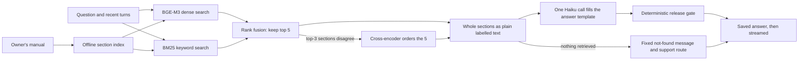

# MotoMedic

MotoMedic is a text assistant that answers rider questions about one document: the **Royal Enfield New Himalayan 450 BS6 owner's manual**. For each question it does three things:
1. **Retrieval.** It retrieves the five most relevant chunks of the manual.
2. **Generation.** It sends the whole manual section around each chunk to one Haiku call, which fills a fixed answer template.
3. **Release gate.** A deterministic release gate either publishes that answer or fails closed. A released answer is saved before the rider sees it.

**New here? Read the [review guide](docs/REVIEW_GUIDE.md) first.**

## Where things stand (25 October 2026)

| Item | State |
| --- | --- |
| Answer path | Implemented and tested without a provider; frozen as [serving manifest v11.1](releases/serving_manifest_v11_1.json) on `main`. |
| Hosted service | **Not deployed.** The Google Cloud project's billing is disabled, so the hosted services are offline. Deploying needs a new owner decision. |
| Experiments | Run here, in Claude Code. [`tools/local_answer.py`](tools/local_answer.py) runs the real retrieval and gate on the real index. A Claude Code Haiku subagent writes the answer instead of the paid API ([how](docs/EXPERIMENTS.md)). |
| Evidence | A 30-question local run in which the generators were Claude Code subagents and the answers were agent-scored. Haiku at high effort answered 30/30 correctly with no unfaithful citation ([evaluation](evals/20261025_answer_release_v3/README.md)). This is not hosted or human acceptance. |

## How an answer is produced



1. **Index (built once, offline).** The manual's Docling parse is regrouped into 154 content sections:
   - each WARNING, CAUTION and NOTE box joins the section it follows;
   - text that continues across a page break stays in one section;
   - each of the 532 search chunks is prefixed with its real heading and embedded with BGE-M3.
2. **Retrieval.** Dense search and BM25 keyword search are fused, and only the top 5 chunks are kept. A cross-encoder reorders those 5 only when the two searches disagree on the top-3 sections.
3. **Model input.** The model receives the whole section of each chunk as plain text with short labels such as `[E7] (WARNING) …`. Every WARNING and CAUTION line sent is listed for an explicit decision. There is no review layer, no parser JSON and no server-added warning text.
4. **One call.** `claude-haiku-5-5` (effort high, thinking disabled) fills the template:
   - answer, policy and watchout sentences, each citing its labels;
   - disclaimers;
   - an INCLUDED or NOT_APPLICABLE decision for every warning sent.
5. **Gate.** The gate checks:
   - the schema and caps;
   - that every citation is a label that was sent;
   - that numbers come from the cited line or the question, and page references from a cited line;
   - the route rules and the warning decisions.

   Anything else is a system error. It checks structure, citations, numbers and warning decisions, not meaning.
6. **Delivery.** The released view is saved in Firestore before any text streams. A refresh replays the saved text and never calls the model again.

## Repository map

| Folder | What it holds |
| --- | --- |
| [docs/](docs/) | [Review guide](docs/REVIEW_GUIDE.md), [architecture](docs/ARCHITECTURE.md), [product](docs/PRD.md) and [technical](docs/TRD.md) requirements, [status](docs/STATUS.md), [setup](docs/SETUP.md), [local experiments](docs/EXPERIMENTS.md), [decision log](docs/DECISIONS.md), [TODO](docs/TODO.md) |
| [source/](source/README.md) | The 149-page manual, its source manifest and the graph links used by ingestion |
| [ingest/](ingest/README.md) | The base ingestion job (Docling parse, chunks, embeddings) whose parse the section index reuses |
| [cloud/](cloud/README.md) | Serving code: [answer path](cloud/grounded_generation/), [API and worker](cloud/arm_a/), [shared types](cloud/common/), Qdrant wrapper, billing guard |
| [rider_ui/](rider_ui/README.md) | Streamlit rider interface, public gateway and API client |
| [tools/](tools/README.md) | Release freeze/verify, repository check and the local experiment tool |
| [evals/](evals/README.md) | Answer-quality evaluations, newest last |
| [releases/](releases/README.md) | Frozen serving manifests and the latest owner decision |
| [archive/](archive/README.md) | History: earlier designs, review packages, receipts and retired code. Not used by the current path. |

## Check it yourself

```sh
git clone https://github.com/Maneshwar-Kumar/motomedic-ai.git && cd motomedic-ai
python tools/check_repository_structure.py          # layout, links, manual hash, frozen inputs
python tools/serving_release.py verify               # every serving input against manifest v11.1
```

The provider-free test suite (about 210 tests, all synthetic, no paid calls) is listed in [SETUP](docs/SETUP.md) and runs in [CI](.github/workflows/ci.yml). To ask your own question with a Claude Code generator, see [EXPERIMENTS](docs/EXPERIMENTS.md). Forking supplies no cloud or model credentials.
