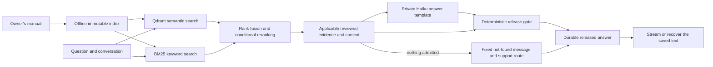

# MotoMedic AI

MotoMedic is a text assistant for questions about the **Royal Enfield New Himalayan 450 BS6 owner's manual**. It retrieves relevant manual evidence, writes the answer privately in one model call, checks it with a deterministic release gate, then saves and displays it.

**[Open the public demo](https://motomedic-rider-ui-279945185781.us-central1.run.app)** · [Review PR #4](https://github.com/Maneshwar-Kumar/motomedic-ai/pull/4) · [Current results](docs/STATUS.md) · [Evaluations](reports/evals/README.md) · [Setup guide](docs/SETUP.md)

The implementation under review is on `codex/public-evaluator`; `main` remains the baseline. The current goal is a working text MVP. The hosted demo is offline while billing is disabled; see [status](docs/STATUS.md).

## Using the demo

Confirm that your motorcycle is the Himalayan BS6 by checking the box on the left margin, then ask a question in your own words, using up to 100 words. MotoMedic shows progress while it retrieves, writes and checks the answer. A completed answer can contain supported facts or procedures, an explicitly limited partial answer, a needed clarification or a manual-supported safety stop. When it cannot support an answer, it says so; a failed technical check produces a separate system-error message.

The source is the supplied [149-page owner's manual](royal-enfield-new-himalayan-450-owners-manual-bs-six-english.pdf), edition RAM00818/A, dated 4 November 2025. Questions are not restricted to a predefined catalogue. The application is currently text-only; photo and voice features are deferred.

## How an answer is produced



1. The worker searches the existing index. Semantic search and keyword search run concurrently. Reciprocal rank fusion combines their results, and a cross-encoder reranks candidates when the two searches disagree about section ordering.
2. Evidence assembly adds the applicable reviewed dependencies, including warnings, conditions, units, table headers and references. Relevant conversation history is retained. Search relevance alone does not authorize an answer. If nothing is admitted, no model call is made and the rider gets the fixed not-found message and support route.
3. Pinned `claude-haiku-5-5` fills the answer template privately in one call:
   - cited answer, policy and watchout sentences;
   - disclaimers;
   - a decision for every manual warning in the evidence.
4. A deterministic release gate checks the schema, that every cited item cites admitted evidence, that numbers and page references come from the cited objects or the question, the route rules and the warning decisions. It then composes the text. An UNSUPPORTED answer shows any cited facts, then the fixed not-found message. A gate failure, malformed output or outage is a system error; there is no verifier, correction round, alternative model or automatic paid replay.
5. The worker saves a released answer in Firestore before the UI receives answer text. Streaming and recovery read the same saved buffer, so a browser refresh does not require a new answer-generation call.

## Architecture choices

The manual is parsed, chunked and embedded before serving. Its immutable index contains **532 chunks, 277 parent sections, BGE M3 vectors and BM25**. Requests embed only the retrieval query; they never reparse or re-embed the document. This keeps source versions reproducible and avoids repeating document processing on every question.

Hybrid retrieval combines semantic matches with exact terminology and numbers. Rank fusion avoids treating the two search scores as interchangeable. Conditional reranking focuses additional ranking work on cases where the searches disagree.

There is one model call per answer. The owner removed the separate verifier on 24 October 2026 because the answer template and the deterministic gate set the release bar, and one call is faster. The gate checks structure, citations, numbers and warning decisions, not meaning, so a released answer is not independent proof of factual correctness. The [evaluations](reports/evals/README.md) measure this path on 30 questions. **The deployed v10.14 backend still uses the retired draft-then-verify path** until a new version ships.

The durable worker owns the answer operation even if the browser disconnects. Cloud Tasks dispatches work references, and Firestore stores the operation, conversation and accepted result. Ownership checks and fenced execution prevent a repeated request from silently starting the same paid work again.

## What runs where

| Component | Responsibility | Code |
| --- | --- | --- |
| Cloud Run UI | Streamlit chat interface and gateway; scope confirmation, progress, answer display and recovery. | [rider_ui](rider_ui/README.md) |
| Cloud Run API | Validates input and visitor ownership, creates durable operations and serves saved results. | [rider_api.py](cloud/arm_a/rider_api.py) |
| Cloud Run answer worker | Retrieval, evidence assembly, the generation call, the release gate and durable commit. | [durable_dispatch.py](cloud/arm_a/durable_dispatch.py), [verified_qa.py](cloud/grounded_generation/verified_qa.py) (deployed), [release gate candidate](reports/evals/20261024_answer_release_v1/candidate/answer_release.py) |
| Qdrant and worker CPU | Stored-vector semantic search, BGE M3 query embedding, BM25, fusion and conditional cross-encoder reranking. | [serving_retrieval.py](cloud/grounded_generation/serving_retrieval.py) |
| Firestore | Conversation state, operation leases, saved answers and persistent admission limits. | [store.py](cloud/arm_a/store.py) |
| Cloud Storage | Versioned source/index artifacts, checked against their recorded hashes at startup. | [serving_artifacts.py](cloud/serving_artifacts.py) |
| Anthropic | Pinned Haiku, one generation call per answer. | [role_router.py](cloud/grounded_generation/role_router.py), [cached_verifier.py](cloud/grounded_generation/cached_verifier.py) |
| Cloud Build and GitHub Actions | Hosted container builds and provider-free contract/UI checks. | [serving_release.py](tools/serving_release.py), [CI workflow](.github/workflows/ci.yml) |

The browser uses the UI. API writes, worker execution and private operation reads require verified service identities and visitor/task authorization. Selected health and read-only retrieval routes are available for reviewer inspection; credentials and rider records are not public.

## What is built and what has been tested

The deployed v10.14 text path includes immutable-index retrieval, complete evidence assembly, private drafting and separate verification (the retired path), durable operations, saved-buffer streaming and recovery. **“When is the service due for my bike?” returned a supported answer with a citation in the [public browser check](reports/public_evaluator/20261012/public_review/browser_service_due_v14_v2/receipt.json), in 71.33 seconds.** A [separate private check](reports/public_evaluator/20261012/haiku_v10_14_helpers/service_due_api_operator_v2/hosted_runs/4133435e-9cb0-4281-98f4-d0c6bddda570/service_due_case.json) verified a useful partial answer and confirmed identical saved, streamed and recovered content. Backend v10.14 preserves applicable reviewed evidence through reranking and reuses the existing v10.13 UI.

The first public attempt at that question failed a verifier consistency check and displayed a system error; a fresh operation passed. That verifier was probabilistic, and successful demonstration cases do not establish correctness for every question. A rollback check timed out twice on the previous backend's health endpoint; v10.14 traffic was restored and its health checks passed. [Status](docs/STATUS.md) records the actual failures and limits. Software tests and builds are reported separately from returned-answer evidence.

## Clone, inspect and test

```sh
git clone https://github.com/Maneshwar-Kumar/motomedic-ai.git
cd motomedic-ai
git switch codex/public-evaluator
```

Use the [setup guide](docs/SETUP.md) for dependencies, provider-free checks and reproduction with your own hosted credentials. The existing [immutable index release](https://github.com/Maneshwar-Kumar/motomedic-ai/releases/tag/index-a3282c4d98cf54595e4ba168) is public and can be downloaded and verified without recomputing document embeddings. Forking the repository does not supply the original cloud or model credentials.

[GitHub Actions](https://github.com/Maneshwar-Kumar/motomedic-ai/actions/workflows/ci.yml) tests source bindings, retrieval, model contracts, admission, durable state, delivery and the UI using synthetic providers and stores. Those tests require no paid model calls. Full hosted reproduction additionally needs the pinned query model assets, your own cloud services and an Anthropic credential; the setup guide explains those boundaries.

For more detail, read the [product requirements](docs/PRD.md), [technical requirements](docs/TRD.md), [architecture](docs/ARCHITECTURE.md), [reviewer guide](docs/REVIEWER.md) and [current TODO](TODO.md). Contributions follow [CONTRIBUTING.md](CONTRIBUTING.md).
