# MotoMedic AI

MotoMedic is a text assistant for questions about the **Royal Enfield New Himalayan 450 BS6 owner's manual**. It retrieves the five most relevant manual chunks and sends their whole sections to one Haiku call, which fills an answer template. A deterministic gate releases the answer or fails closed, and the released answer is saved before it is shown.

[Current status](docs/STATUS.md) · [Evaluations](reports/evals/README.md) · [Setup guide](docs/SETUP.md) · [Review PR #4](https://github.com/Maneshwar-Kumar/motomedic-ai/pull/4)

Work is on `codex/public-evaluator`; `main` remains the baseline. This answer path is implemented, tested without a provider and frozen as [serving manifest v11](reports/public_evaluator/20261025/serving_manifest_v11.json). **It is not deployed.** The hosted stack is offline while billing is disabled, and deploying needs a new owner scope; see [status](docs/STATUS.md).

## How an answer is produced

```mermaid
flowchart LR
    PDF[Owner's manual] --> INDEX[Offline section index]
    Q[Question and recent turns] --> DENSE[BGE-M3 dense search]
    Q --> BM25[BM25 keyword search]
    INDEX --> DENSE
    INDEX --> BM25
    DENSE --> FUSE[Rank fusion: keep top 5]
    BM25 --> FUSE
    FUSE -->|top-3 sections disagree| RERANK[Cross-encoder orders the 5]
    FUSE --> SECTIONS[Whole sections as plain labelled text]
    RERANK --> SECTIONS
    SECTIONS -->|nothing retrieved| FALLBACK[Fixed not-found message and support route]
    SECTIONS --> GEN[One Haiku call fills the answer template]
    GEN --> GATE[Deterministic release gate]
    GATE --> SAVE[Durable saved answer]
    FALLBACK --> SAVE
    SAVE --> UI[Stream or recover the saved text]
```



1. **Index, built once.** The manual's cached Docling parse is regrouped into 154 content sections:
   - each WARNING, CAUTION and NOTE box joins the section it follows;
   - page-break continuations stay in one section;
   - the search text of each of the 532 chunks starts with its real heading.

   The chunks are embedded with BGE-M3. Requests embed only the query.
2. **Retrieval.** Dense search and BM25 are fused, and only the top 5 chunks are kept. When the two searches disagree on the top-3 sections, a cross-encoder orders those 5. It never adds a chunk.
3. **Model input.** The model gets the whole section of each chunk as plain text with short labels such as `[E7] (WARNING) …`. Every WARNING and CAUTION line it receives is listed for a decision. There is no parser JSON, no review layer and no server-added warning text.
4. **One call.** Pinned `claude-haiku-5-5` (effort high, thinking disabled) fills the template:
   - cited answer, policy and watchout sentences;
   - disclaimers;
   - a decision for every warning sent.

   The system prompt asks for plain rider wording, only what was asked, and both values when the manual disagrees with itself.
5. **Gate.** The deterministic gate checks:
   - the schema and caps;
   - that each cited item cites only labels that were sent;
   - that numbers come from the cited line or the question, and page references from a cited line;
   - the route rules and warning decisions.

   UNSUPPORTED shows any cited facts, then the fixed not-found message and support route. A gate failure, malformed output or outage is a system error. Nothing is retried and there is no verifier.
6. **Delivery.** The worker saves the released view in Firestore before the UI receives answer text. Streaming and recovery read the same saved view, so a refresh never calls the model again.

The gate checks structure, citations, numbers and warning decisions, not meaning, so a released answer is not independent proof of factual correctness.

## Evaluation behind this design

The same 30 questions were run as isolated subagents in three arms ([v3 run](reports/evals/20261025_answer_release_v3/README.md)). All 19 gold answers reached the model. Results:

| Arm | Released and correct | Unfaithful cited items |
| --- | --- | --- |
| Haiku, default effort | 24/30 (6 structural gate failures) | 0 |
| **Haiku, high effort** (used) | **30/30** | 0 |
| Sonnet | 28/30 | 0 |

These are local, agent-scored runs, not hosted or human acceptance. The serving modules reproduce all 30 model inputs and all 90 gate outcomes of that run ([parity check](reports/evals/20261025_answer_release_v3/serving_parity.json)).

## What runs where

| Component | Responsibility | Code |
| --- | --- | --- |
| Cloud Run UI | Streamlit chat and gateway: scope confirmation, progress, answer display and recovery. | [rider_ui](rider_ui/README.md) |
| Cloud Run API | Validates input and visitor ownership, creates durable operations, streams and recovers saved results. | [rider_api.py](cloud/arm_a/rider_api.py), [app.py](cloud/arm_a/app.py) |
| Cloud Run answer worker | Runs the turn and commits the result. | [durable_dispatch.py](cloud/arm_a/durable_dispatch.py), [section_questions.py](cloud/grounded_generation/section_questions.py) |
| Retrieval | BGE-M3 query vector, BM25, fusion and conditional reranking. Dense search uses hosted Qdrant when configured, or exact search over the same pinned vectors. | [section_retrieval.py](cloud/grounded_generation/section_retrieval.py), [section_index.py](cloud/grounded_generation/section_index.py) |
| Assembly, template and gate | Plain-text sections, the system prompt, the answer schema and the release gate. | [section_assembly.py](cloud/grounded_generation/section_assembly.py), [template_answer.py](cloud/grounded_generation/template_answer.py) |
| Anthropic | One Haiku call per answer, reserved first in the shared ledger. | [haiku_answer.py](cloud/grounded_generation/haiku_answer.py), [whole_turn_admission.py](cloud/grounded_generation/whole_turn_admission.py) |
| Firestore | Conversations, operation leases, saved answers and persistent admission limits. | [store.py](cloud/arm_a/store.py) |
| GitHub Actions | Provider-free contract and UI checks, and the frozen-input check. | [CI workflow](.github/workflows/ci.yml), [serving_release.py](tools/serving_release.py) |

## Clone, inspect and test

```sh
git clone https://github.com/Maneshwar-Kumar/motomedic-ai.git
cd motomedic-ai
git switch codex/public-evaluator
```

The [setup guide](docs/SETUP.md) covers dependencies, the provider-free checks and rebuilding the section index. The rebuild uses the cached parse inside the public [index snapshot](https://github.com/Maneshwar-Kumar/motomedic-ai/releases/tag/index-a3282c4d98cf54595e4ba168). The tests use synthetic providers, stores and a synthetic index, so they make no paid calls. Forking does not supply the original cloud or model credentials.

For more detail, read the [product requirements](docs/PRD.md), [technical requirements](docs/TRD.md), [architecture](docs/ARCHITECTURE.md), [reviewer guide](docs/REVIEWER.md) and [TODO](TODO.md). Contributions follow [CONTRIBUTING.md](CONTRIBUTING.md).
