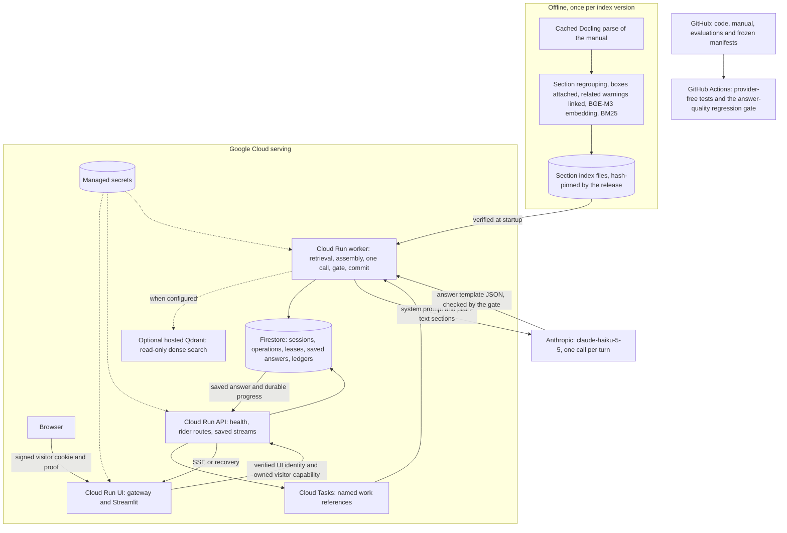

# MotoMedic architecture

MotoMedic answers questions about the selected Himalayan BS6 owner's manual:
- top-5 hybrid retrieval over a section index;
- the whole section of each chunk sent as plain text;
- one Haiku `claude-haiku-5-5` call that fills the answer template;
- a deterministic release gate.

There is no review layer and no verifier. The worker saves the released answer before the API streams or recovers that same buffer. The path is frozen as [serving manifest v11.3](../releases/serving_manifest_v11_3.json) and is **not deployed**; see [status](STATUS.md). Until it is, experiments run the same code locally with a Claude Code subagent as the generator ([EXPERIMENTS](EXPERIMENTS.md)).

## What runs where

The design targets Google Cloud project `motomedic-ai-20261009`, region `us-central1`. The model is called through Anthropic's HTTPS API.

| Component | Responsibility | Code |
| --- | --- | --- |
| Browser UI | Gateway in front of loopback Streamlit. Shows scope confirmation, progress, saved text and follow-ups. | [UI](../rider_ui/README.md), [gateway](../rider_ui/public_gateway.py), [client](../rider_ui/client.py) |
| API | Public GET `/v1/health`. Every other route needs verified service identity plus visitor and operation authorization. Validates questions up to 100 words, saves durable work, dispatches it and streams the saved view. | [rider_api.py](../cloud/arm_a/rider_api.py), [app.py](../cloud/arm_a/app.py) |
| Answer worker | Runs a task under its exact Cloud Tasks identity, then commits. A browser disconnect does not cancel it. | [durable_dispatch.py](../cloud/arm_a/durable_dispatch.py), [section_questions.py](../cloud/grounded_generation/section_questions.py) |
| Section index | Built offline, loaded and hash-verified at startup. | [section_index.py](../cloud/grounded_generation/section_index.py) |
| Retrieval | BGE-M3 query vector and BM25 run on the worker CPU, with RRF top 5, conditional reranking and a relevance floor. Dense search uses hosted Qdrant when `MOTOMEDIC_QDRANT_URL` is set, or exact search over the same pinned vectors. | [section_retrieval.py](../cloud/grounded_generation/section_retrieval.py) |
| Model input and gate | Plain labelled sections, the system prompt, the native answer schema and the deterministic gate. | [section_assembly.py](../cloud/grounded_generation/section_assembly.py), [template_answer.py](../cloud/grounded_generation/template_answer.py) |
| Generation | One reserved Haiku call, with the system prompt cached for 5 minutes. | [haiku_answer.py](../cloud/grounded_generation/haiku_answer.py) |
| Telemetry | Allowlisted structured logs and spans for each turn, worker run and request, correlated by trace id, with no rider text ([privacy](PRIVACY.md)). | [telemetry.py](../cloud/common/telemetry.py) |
| Durable state and ledgers | Sessions, operations, fenced leases, saved views, visitor quotas, the 100-attempt allocation and the Haiku money reservations. Tokens are counted but have no ceiling. | [store.py](../cloud/arm_a/store.py), [whole_turn_admission.py](../cloud/grounded_generation/whole_turn_admission.py) |

## One rider turn

1. **Admission.** The UI confirms the Himalayan BS6 source. The API checks the signed visitor, input limits, ownership, operation key and admission, then saves the work and dispatches it.
2. **Session check.** The worker checks the session's manual, index and runtime locks.
3. **Retrieval.** The worker builds the retrieval query, keeping the prior topic for short follow-ups. Dense search and BM25 rank the chunks, and RRF keeps the top 5. The cross-encoder scores those 5. If the dense and BM25 top-3 sections differ, it also orders them.
4. **Assembly.** The whole section of each chunk is rendered as plain labelled lines, with its WARNING, CAUTION and NOTE boxes. A subsection split from its parent also carries the parent's warnings. The WARNING and CAUTION labels are listed for a decision. If no line is readable, or the best cross-encoder score is below the relevance floor, the fixed fallback and support route are saved with no model call.
5. **Generation.** The request is counted and one `generate` slot is reserved in the shared ledgers. Haiku fills the answer template once.
6. **Gate.** The deterministic gate checks the schema and caps, that cited labels were sent, numbers and page references, an uncited disclaimer's values, the route rules and every warning decision. It then composes the rider text from the released sections:
   - an internal label or field name fails the turn;
   - a meta phrase about "the sections supplied" is reworded;
   - a policy, watchout or disclaimer sentence that only repeats an earlier section is left out.

   UNSUPPORTED shows any cited facts, then the fixed fallback and support route.
7. **Failure.** A gate failure, malformed output, quota, outage or integrity failure is SYSTEM_ERROR. Nothing is retried, and an uncertain paid call is never replayed.
8. **Observation.** The worker logs one `answer_turn` event and its stage spans: retrieval hits, gate outcome, failure reason, tokens and timings. It never logs the question or answer text.
9. **Commit and delivery.** The view is bound to the operation and runtime, validated and committed in one Firestore transaction. The API then streams slices of the saved text, and recovery returns the same saved view.

SUPPORTED includes complete and explicitly partial answers. AMBIGUOUS, UNSUPPORTED, SAFETY_STOP and SYSTEM_ERROR stay distinct. The gate checks structure, citations, numbers and warning decisions, not meaning; a released answer is not independent factual proof.

## Build, test and release boundaries

[GitHub Actions](../.github/workflows/ci.yml) first runs the repository structure check and the v11.3 frozen-input check, comparing against the committed blobs. It then runs the provider-free unit tests, the UI tests and the [answer-quality regression gate](../evals/regression/README.md). The gate re-gates and rescores the saved baseline run, and fails when a prompt, model, index, retrieval or assembly change has no new passing run. It requests no provider secret and does not establish hosted answer quality.

[serving_release.py](../tools/serving_release.py) freezes and verifies the serving manifest (currently v11.3). A freeze is refused unless the regression receipt passes. Inside an image, [check_installed_serving_release.py](../tools/check_installed_serving_release.py) re-checks the installed bytes, the policy and the section index at `build/section-index`. The [Dockerfile](../cloud/arm_a/Dockerfile) runs that check during the build.

Preparing a v11.3 build context is a later owner-scoped step. So are the hosted build, deployment and any Qdrant collection for the new index. A release record must name the Ready revisions, configuration, traffic, the source, index, runtime and image bindings, rollback and restore.

## Source and spending controls

The source is the 149-page RAM00818/A owner's manual, SHA-256 `cf221a29e2f9cd5af6e80a99774a697c814e8eda661c27d72e519d8a7e80da89`. The section index `index_f768fbb216836c003701079e` derives from the cached parse of the public snapshot `index_a3282c4d98cf54595e4ba168`, built by [ingest/](../ingest/README.md). Every parsed object can be cited. Earlier review packages are golden-answer data, not a gate. Docling's page 103 gap stays flagged.

The generation call uses the existing shared Haiku USD1 ledger and the 100-attempt allocation. The token ceiling was removed on 25 October 2026 ([decision v5](../releases/owner_decision_v5.json)). The relevance floor saves a call only when retrieval finds nothing close. Historical reservations stay charged; there is no reset, refund or new allocation. The INR3,120 lifetime budget and the INR2,960 billing-disconnect guard remain. Stopped billing is never restarted without the owner.
