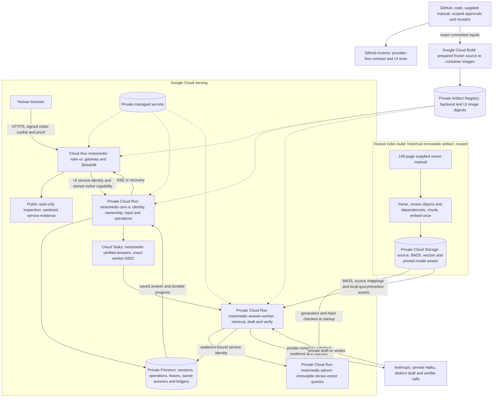

# MotoMedic architecture

MotoMedic answers questions about the selected Himalayan BS6 owner's manual. Haiku `claude-haiku-5-5` drafts privately, and a separate Haiku call verifies the exact finalized answer. The worker saves the accepted answer before the API streams or recovers that same buffer.

**12 October 2026: v10.13 is being prepared.** The owner has authorized a public UI preview with answering paused while current answer-quality checks finish, public repository/manual access and anonymous read-only service inspection. Public availability and current deployed revisions must be established by operational receipts; these permissions do not establish answer-quality acceptance. V10.12 failed independent live review. See [current status](STATUS.md), [reviewer guide](REVIEWER.md) and [clone/fork setup](SETUP.md).

## What runs where

All current Google Cloud services are in project `motomedic-ai-20261009`, region `us-central1`. The stopped `motomedic-inference-20261009` project is not the model host; its billing remains disabled. The answering model is called through Anthropic's HTTPS API.

The inspection branch represents the newly authorized publication work; its live route/readback remains pending. It must not provide arbitrary upstream URLs, credentials, raw job execution, rider records or private draft access.

| Component | Execution and responsibility | Code or evidence |
| --- | --- | --- |
| Browser UI | Cloud Run gateway fronts loopback Streamlit; presents scope, progress, saved text and follow-up. Preview mode pauses answer submission. | [UI](../rider_ui/README.md), [gateway](../rider_ui/public_gateway.py), [client](../rider_ui/client.py) |
| API | IAM-protected Cloud Run service validates visitor ownership, questions up to 100 words and idempotency; writes durable work, dispatches it and observes saved results. | [API](../cloud/arm_a/rider_api.py), [production wiring](../cloud/arm_a/app.py) |
| Answer worker | Separate IAM-protected Cloud Run service using the backend image. Performs retrieval, complete evidence assembly, private drafting, final verification and durable commit. Browser disconnection does not cancel its operation. | [worker](../cloud/arm_a/durable_dispatch.py), [generation](../cloud/grounded_generation/verified_qa.py) |
| Dense retrieval | Private Qdrant wrapper restores existing vectors, then exposes only `/health` and source/index-bound `/query`. It does not expose a native dashboard or collection-management API. | [wrapper](../cloud/qdrant/boot.py), [recorded deployment](../cloud/deployment_status.json) |
| Sparse retrieval and ranking | BGE M3 query embedding, BM25 and pinned cross-encoder run on the hosted worker's CPU. Dense RPC and BM25 run concurrently; RRF combines them. Reranking is conditional on observed distinct-parent rank disagreement. | [retrieval](../cloud/grounded_generation/serving_retrieval.py) |
| Durable state | Firestore owns sessions/history, operations, fenced leases, accepted buffers, visitor quotas and permanent token/money reservations. | [store](../cloud/arm_a/store.py), [admission](../cloud/grounded_generation/whole_turn_admission.py) |
| Dispatch | Named Cloud Tasks carry a work reference, not the raw work snapshot. Exact task-caller identity/audience and persistent state prevent redelivery from repeating paid work. | [dispatch](../cloud/arm_a/durable_dispatch.py), [setup receipt](../reports/public_evaluator/20261012/operations/setup_v1.json) |
| Model calls/cache | Both roles use pinned Haiku with distinct policies, schemas and instances. Each caches its own policy/evidence prefix for five minutes; question/history/final answer are dynamic. Answer-cache shortcuts and availability fallback are disabled. | [contracts](../cloud/grounded_generation/role_contracts.py), [adapters](../cloud/grounded_generation/cached_verifier.py) |
| Offline source/index | Hosted ingestion created the immutable index before serving. Requests never parse or re-embed the manual. Startup reloads generation/hash-bound artifacts. | [source](../source_manifest.json), [loader](../cloud/serving_artifacts.py) |

## One rider turn

1. The UI confirms the selected Himalayan BS6 source. The private API checks the signed visitor, input limits, ownership, operation key and persistent admission, then saves and dispatches work.
2. The worker prepares a history-aware retrieval query. Authenticated dense retrieval and BM25 run concurrently; RRF, conditional reranking and bounded reviewed-dependency recovery select evidence.
3. Assembly preserves complete applicable evidence, original admitted IDs, warnings, prerequisites, conditions, units, headers, references and relevant history. Missing extraction or review is a maintainer failure. No old assembled-evidence cap or silent truncation applies.
4. Native request counts, native windows and persistent budgets are checked separately. The initial private draft/verifier phase reserves two role-bound calls against the existing ledgers.
5. Haiku drafts privately. The server finalizes text, conditions, warnings and citations. A separate Haiku call checks every claim against each cited original object and binds the exact finalized answer, evidence, question, history and runtime.
6. One correctable rejection may permit one corrected draft and new verification, admitted as a separate phase. Malformed output, quota, outage or integrity failure is `SYSTEM_ERROR`; uncertain provider completion never triggers automatic paid replay or refund.
7. Final binding checks precede the Firestore commit. The API streams slices of the saved buffer. Recovery and completed replay return that same operation's saved answer without another model call.

`SUPPORTED` includes useful complete or explicitly partial answers. `AMBIGUOUS`, `UNSUPPORTED`, `SAFETY_STOP` and `SYSTEM_ERROR` remain distinct. Applicable source-specific safety has priority. A model verdict is probabilistic; independent original-page review remains a separate acceptance gate.

## Build, test and release boundaries

[GitHub Actions](https://github.com/Maneshwar-Kumar/motomedic-ai/actions/workflows/ci.yml) runs the complete published [CI workflow](../.github/workflows/ci.yml) on pull requests, pushes to `main` and manual dispatch. It checks navigation/source approvals, frozen bytes and committed serving inputs; then tests provider, admission, retrieval, managed-store, delivery and UI contracts using synthetic doubles. It requests no provider secrets and does not establish hosted answer quality.

Google Cloud Build separately builds Linux containers from prepared, generation/hash-bound source archives. The canonical build configuration is generated by [serving_release.py](../tools/serving_release.py); submitting the historical raw [cloudbuild.yaml](../cloud/arm_a/cloudbuild.yaml) intentionally fails. Backend and UI images bind source commit, frozen manifest, input tree and image digest. API and worker share the backend image. Hosted native-count/evaluator jobs use explicit scope and ledger readback; they are separate from ordinary CI.

Release evidence must identify actual Ready revisions, full material configuration, traffic, source/index/runtime/model/image bindings, rollback and restore health. Browser recovery, current-role cache creation/reads and independent answer/source quality need actual hosted receipts. The [v10.12 CI run](https://github.com/Maneshwar-Kumar/motomedic-ai/actions/runs/38223614708) and successful builds did not prevent its citation/draft failures; they are historical software evidence, not v10.13 acceptance.

## Source and spending controls

The source is the 149-page RAM00818/A owner's manual, SHA-256 `cf221a29e2f9cd5af6e80a99774a697c814e8eda661c27d72e519d8a7e80da89`. The immutable index `index_a3282c4d98cf54595e4ba168` contains 532 chunks, 277 parents and BM25. Exact [161-case delegated source approval](../human_review/agent_release_161/README.md) and additional pinned packages remain scope-bound; a heading does not approve a whole parent. Docling page 103 remains flagged.

The owner's latest instruction authorizes publishing the supplied manual for inspection. Historical source/display manifests retain their original bytes; public access does not change claim approval or imply a separately verified OEM redistribution licence. No credentials or rider records belong in Git or public inspection.

Both Haiku roles share the existing USD1 ledger and the existing 100-attempt primary ledger. The default legacy lifetime token ceiling stays 999,200. A separately recorded, exact direct-owner grant may increase only that ceiling, up to the compiled 3,000,000 bound; this mechanism is dormant until measured proposal approval and atomic application. It preserves all historical counters/charges, attempts, USD1, INR2,700 lifetime and INR2,540 billing-disconnect guard. [Admission review](../reports/public_evaluator/20261012/haiku_v10_13/admission/synthetic_validation_v1.json) is provider-free evidence, not an applied grant. Stopped billing is never restarted implicitly.
