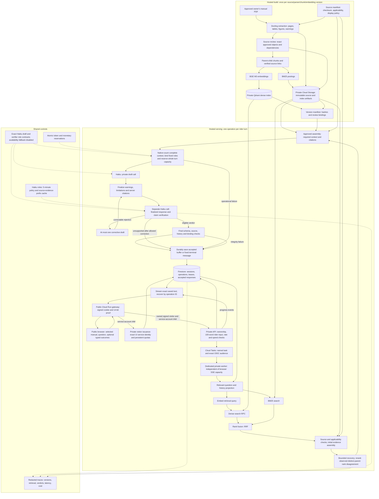

# MotoMedic architecture

**Latest owner direction: Haiku only.** Use `claude-haiku-5-5` for drafting and a separate verification call, with different role policies/schemas. This supersedes Gemini and the different-model requirement. The session is stopped; the Haiku-only migration is the first next-chat TODO. Frozen v10.11 is superseded, unbuilt WIP and must not be deployed. Read [model scope3](../reports/public_evaluator/20261012/owner_model_scope_v3.json).

Selected v10 public evaluator: 12 October 2026, following the 11 October reset. [PRD.md](PRD.md) defines product behavior; [TRD.md](TRD.md) defines implementation contracts. [TODO.md](../TODO.md) gives the execution sequence.

Build a hosted assistant for the selected Himalayan BS6 owner's manual. Reuse the immutable index, accept rider questions up to 100 words, retrieve complete applicable evidence, draft with Haiku and separately verify the finalized response with another Haiku call. Save before exact streaming. Only UI may be public. The session stopped; Haiku-only migration and live acceptance remain pending.

This diagram describes the required architecture. It does not claim that every connection is deployed or accepted.

Dense Qdrant RPC and BM25 execute concurrently after a history-aware retrieval query is prepared. RRF fuses their ranks; relevance alone never authorizes an answer. Runtime retrieval v3 compares ordered top-three distinct parent ranks and reranks once only when observed comparable positions differ. Sibling chunks, absent backend ranks, unmatched trailing depth and close RRF margins do not create disagreement. One bounded recovery may retrieve missing reviewed dependencies. Missing source approval is a maintainer problem, not a reranking trigger or rider question.

Evidence assembly retains immutable evidence IDs, original page metadata, applicable conditions, warnings, specifications, units, table headers and verified references. Admit reviewed objects at their approved scope. A reviewed heading does not approve its entire parent body. Assemble compact complete context around approved evidence and mandatory dependencies; never omit required context to fit the model.

The [latest model scope](../reports/public_evaluator/20261012/owner_model_scope_v3.json) selects Haiku `claude-haiku-5-5` only, with separate draft/verifier invocations and different role policies/schemas. Bind call roles and exact response/evidence/history before release. This supersedes different-model identity, while independent original-page review remains mandatory. Native windows, throughput and persistent budgets are separate constraints. Five-minute role-specific caches retain policy/evidence only; dynamic question/history/answer remain uncached.

Drafting and verification are separate calls. Verification binds the exact finalized response, claims, question, relevant history, evidence and runtime versions. A partial answer states its limitation before verification. At most one correction and re-verification is allowed. Verification cannot cure wrong applicability, missing mandatory context or invalid citations.

Save only after final checks pass. Progress may be displayed while work proceeds; unchecked drafting tokens stay private. Stream slices of the saved accepted buffer; recovery returns the same response and hashes. Named authenticated Cloud Tasks dispatch to a dedicated private worker, separate from API/SSE request capacity, with fenced leases and a 1,200-second operation deadline. An uncertain provider completion cannot trigger automatic paid replay. Code is implemented; hosted worker/disconnect acceptance remains pending.

The direct public gateway signs a secure HttpOnly 24-hour visitor cookie after a 14-bit proof challenge and successful private visitor reservation. Challenges expire in 120 seconds, spent proofs are rejected atomically, and issuance is bounded globally at ten/minute and 60/rolling day. Only the exact UI service identity may reserve a visitor. The gateway makes no trusted client-IP claim; browser forwarding headers supply no authority. A signed nonce preserves visitor identity across refresh/new conversations; cookie replacement creates a new subject but cannot reset persistent global issuance/request or non-recurring provider ledgers.

| Rider outcome | Meaning and delivery |
| --- | --- |
| `SUPPORTED` | Verified complete or explicitly partial manual-backed answer. |
| `AMBIGUOUS` | One focused question about a rider-resolvable ambiguity supported by the source. |
| `UNSUPPORTED` | No releasable answer after permitted checks; fixed manual fallback and verified service route. |
| `SAFETY_STOP` | Applicable source-specific safety stop with priority over ordinary answering. |
| `SYSTEM_ERROR` | Provider, quota, malformed output, integrity, storage or other operational failure; fixed retry message. |

Fallback: “I couldn’t find relevant information in the selected manual to answer your question. Please contact Royal Enfield or an authorised service centre.”

System error: “I couldn’t check the answer right now. Please try again shortly.”

Fallback does not assert that the entire manual has no answer. Neither fixed message requires a successful model call. Citations expose authorized metadata and the verified OEM route; source policy prohibits rider access to the PDF, excerpts and figure crops.

| Storage | Responsibility |
| --- | --- |
| Private Cloud Storage | Immutable PDF/extraction/index artifacts and manifests identified by generation and hash. |
| Private Qdrant | BGE M3 vectors and selected-manual/version-filtered dense retrieval. |
| Versioned BM25 snapshot | Sparse retrieval over the same manual and chunk mappings, loaded once per worker/index version. |
| Firestore | Owned sessions, optional typed observations/attempts, idempotent operations, leases, accepted buffers and atomic quota/spend reservations. |
| Managed secrets | Provider credentials available only to authorized backend identities. |
| Redacted telemetry | Stage timing, verdicts, error categories, exact versions and estimated cost; no raw rider media or routine transcript copies. |

`ACTION_COMPLETED_UNRESOLVED` remains distinct from an observed normal component. Ordinary questions require neither authored question IDs nor diagnostic StepDefinitions. Selected verifier prompt caching remains separate from answer authority and needs a hosted creation/read receipt; savings need paired measurements. Historical Gemma/v8 cache evidence does not establish this new capability. Exact-answer shortcuts remain disabled.

## Current baseline and gaps

The 149-page owner's manual has SHA-256 `CF221A29E2F9CD5AF6E80A99774A697C814E8EDA661C27D72E519D8A7E80DA89`. Existing candidate index `index_a3282c4d98cf54595e4ba168` contains BGE M3 vectors, 532 search chunks, 277 parents and BM25, with private Qdrant infrastructure. Exact owner-delegated source approvals remain version- and scope-bound; they do not automatically approve general generation or public display.

| Area | Implemented v10 candidate | Remaining acceptance |
| --- | --- | --- |
| Retrieval/ranking | V10.6 native-count traces prove authenticated Qdrant + concurrent BM25 and actual reranking on all six disagreements. Reviewed dependencies/gap obligations are retained. | Useful-answer evidence recall and new context-selection acceptance. |
| Source admission | Exact reviewed closure retains warnings, references, headers and units; v10.6 useful draft contexts counted 12,438–18,437 tokens. | Large applicable evidence is allowed. Approved final-ranked closure/gap recovery and native selected-role counts remain pending; semantic projection is unimplemented. |
| Models/cache | Haiku-only selected for separate draft/verifier calls; historical verifier-prefix cache proof retained. | Haiku-only runtime/admission/fixture migration, complete native counts, current-role cache usage and original-page review. |
| History/delivery | Follow-up topic projection, durable task/operation fencing and exact saved recovery. V10.6 API/worker/UI private readiness passed with zero provider work. | New-candidate readiness, browser disconnect/recovery and cold/warm timings. |
| Public controls | Signed cookie/proof gateway with private visitor admission; private backend/worker/Qdrant. V10.4 private shell passed proof/cookie/WebSocket, checked scope and enabled input without a paid turn. | Current anonymous public-browser flow, persistent quotas, retention and redaction; private shell alone is not public acceptance. |
| DevOps | V10.10 hosted CI/images/private readiness and count preflight passed; its evaluator launcher failed before questions. | Fresh Haiku-only candidate bindings, builds, exact readiness, useful-answer/recovery/rollback and public acceptance. Superseded v10.11 remains unchanged. |

The v8 Haiku run `38160944967` released zero technical answers and answered 0/4 clearly answerable or partial turns; three contexts exceeded 8,192 tokens. Preserve that failed baseline. Current software tests do not establish factual quality or live readiness. [Exact operational scope](../reports/public_evaluator/20261012/owner_scope_v1.json) and [credential approval](../reports/public_evaluator/20261012/owner_credential_scope_v1.json) authorize this evaluator's deployment and bounded validation within existing limits, separate from source approval and acceptance. INR2,700/INR2,540 guards and disabled inference billing remain unchanged. Photo and voice follow text acceptance.
