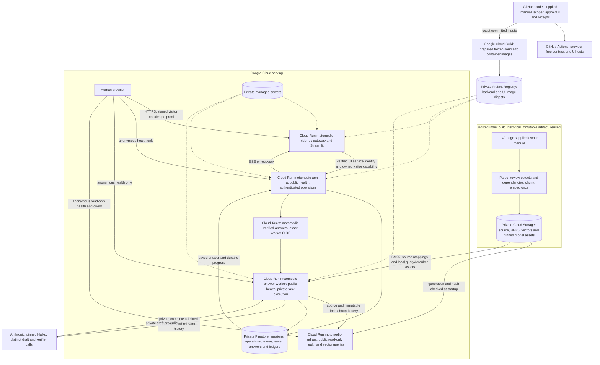

# MotoMedic architecture

MotoMedic answers questions about the selected Himalayan BS6 owner's manual. Haiku `claude-haiku-5-5` drafts privately, and a separate Haiku call verifies the exact finalized answer. The worker saves the accepted answer before the API streams or recovers that same buffer.

**12 October 2026: the repository is public and v10.13 is frozen.** Source commit [3b7da1692187736295fee7345e9b3e932d02b216](https://github.com/Maneshwar-Kumar/motomedic-ai/commit/3b7da1692187736295fee7345e9b3e932d02b216) passed [provider-free CI](https://github.com/Maneshwar-Kumar/motomedic-ai/actions/runs/38233548200). Public paused UI preview, anonymous API/worker health and read-only Qdrant checks passed. The owner [waived independent manual answer review](../reports/public_evaluator/20261012/public_review/owner_functional_acceptance_scope_v1.json) for this functional demonstration. Answering stays paused until the real retrieval/answer/delivery probe; no independent factual acceptance is claimed. V10.12 failed independent live review. See [current status](STATUS.md), [reviewer guide](REVIEWER.md) and [clone/fork setup](SETUP.md).

## What runs where

All current Google Cloud services are in project `motomedic-ai-20261009`, region `us-central1`. The stopped `motomedic-inference-20261009` project is not the model host; its billing remains disabled. The answering model is called through Anthropic's HTTPS API.

Anonymous service readback passed. API and worker allow only anonymous GET `/v1/health`; every other request requires a cryptographically verified Google token with the exact audience and an allowlisted verified service-account email. Visitor, edge and Tasks restrictions still apply. Qdrant exposes only read-only `/health` and source/index-bound `/query`, not native dashboard or management routes. See [exact public-review authority](../reports/public_evaluator/20261012/public_review/owner_public_review_scope_v1.json).

| Component | Execution and responsibility | Code or evidence |
| --- | --- | --- |
| Browser UI | Cloud Run gateway fronts loopback Streamlit; presents scope, progress, saved text and follow-up. Preview mode pauses answer submission. | [UI](../rider_ui/README.md), [gateway](../rider_ui/public_gateway.py), [client](../rider_ui/client.py) |
| API | Cloud Run service exposes public health. Other routes require verified service identity plus visitor/operation authorization; validate questions up to 100 words, save durable work, dispatch and observe results. | [API](../cloud/arm_a/rider_api.py), [production wiring](../cloud/arm_a/app.py) |
| Answer worker | Separate Cloud Run service using the backend image, with public health and exact private task identity for execution. Performs retrieval, complete evidence assembly, private drafting, final verification and durable commit. Browser disconnection does not cancel its operation. | [worker](../cloud/arm_a/durable_dispatch.py), [generation](../cloud/grounded_generation/verified_qa.py) |
| Dense retrieval | Read-only Qdrant wrapper restores existing vectors, then exposes only `/health` and source/index-bound `/query` publicly under the recorded readback. It does not expose a native dashboard or collection-management API. | [wrapper](../cloud/qdrant/boot.py), [recorded deployment](../cloud/deployment_status.json) |
| Sparse retrieval and ranking | BGE M3 query embedding, BM25 and pinned cross-encoder run on the hosted worker's CPU. Dense RPC and BM25 run concurrently; RRF combines them. Reranking is conditional on observed distinct-parent rank disagreement. | [retrieval](../cloud/grounded_generation/serving_retrieval.py) |
| Durable state | Firestore owns sessions/history, operations, fenced leases, accepted buffers, visitor quotas and permanent token/money reservations. | [store](../cloud/arm_a/store.py), [admission](../cloud/grounded_generation/whole_turn_admission.py) |
| Dispatch | Named Cloud Tasks carry a work reference, not the raw work snapshot. Exact task-caller identity/audience and persistent state prevent redelivery from repeating paid work. | [dispatch](../cloud/arm_a/durable_dispatch.py), [setup receipt](../reports/public_evaluator/20261012/operations/setup_v1.json) |
| Model calls/cache | Both roles use pinned Haiku with distinct policies, schemas and instances. Each caches its own policy/evidence prefix for five minutes; question/history/final answer are dynamic. Answer-cache shortcuts and availability fallback are disabled. | [contracts](../cloud/grounded_generation/role_contracts.py), [adapters](../cloud/grounded_generation/cached_verifier.py) |
| Offline source/index | Hosted ingestion created the immutable index before serving. Requests never parse or re-embed the manual. Startup reloads generation/hash-bound artifacts. | [source](../source_manifest.json), [loader](../cloud/serving_artifacts.py) |

## One rider turn

1. The UI confirms the selected Himalayan BS6 source. The authenticated API operation checks the signed visitor, input limits, ownership, operation key and persistent admission, then saves and dispatches work.
2. The worker prepares a history-aware retrieval query. Source/index-bound dense retrieval and BM25 run concurrently; RRF, conditional reranking and bounded reviewed-dependency recovery select evidence.
3. Assembly preserves complete applicable evidence, original admitted IDs, warnings, prerequisites, conditions, units, headers, references and relevant history. Missing extraction or review is a maintainer failure. No old assembled-evidence cap or silent truncation applies.
4. Native request counts, native windows and persistent budgets are checked separately. The initial private draft/verifier phase reserves two role-bound calls against the existing ledgers.
5. Haiku drafts privately. The server finalizes text, conditions, warnings and citations. A separate Haiku call checks every claim against each cited original object and binds the exact finalized answer, evidence, question, history and runtime.
6. One correctable rejection may permit one corrected draft and new verification, admitted as a separate phase. Malformed output, quota, outage or integrity failure is `SYSTEM_ERROR`; uncertain provider completion never triggers automatic paid replay or refund.
7. Final binding checks precede the Firestore commit. The API streams slices of the saved buffer. Recovery and completed replay return that same operation's saved answer without another model call.

`SUPPORTED` includes useful complete or explicitly partial answers. `AMBIGUOUS`, `UNSUPPORTED`, `SAFETY_STOP` and `SYSTEM_ERROR` remain distinct. Applicable source-specific safety has priority. A model verdict is probabilistic. Independent manual answer review is waived for this functional demo by the owner; immutable source approval and separate exact-finalized verification remain required, without independent factual acceptance.

The exact existing 181,153,632-byte index snapshot is published as a [GitHub Release asset](https://github.com/Maneshwar-Kumar/motomedic-ai/releases/tag/index-a3282c4d98cf54595e4ba168), SHA-256 `4248b6f21bede82375a2aceda2205ad8abb63a061abf18c30e9686cd82bba6bc`. The [publication readback](../reports/public_evaluator/20261012/public_review/index_release_readback_v1.json) binds the asset and GitHub digest. This is a byte-identical export, not new ingestion. Original hosted GCS generation/hash bindings remain unchanged. The snapshot includes pinned reranker files; the BGE M3 query model and private inherited container base still require own hosted setup; see [SETUP](SETUP.md).

## Build, test and release boundaries

[GitHub Actions](https://github.com/Maneshwar-Kumar/motomedic-ai/actions/workflows/ci.yml) runs the complete published [CI workflow](../.github/workflows/ci.yml) on pull requests, pushes to `main` and manual dispatch. It checks navigation/source approvals, frozen bytes and committed serving inputs; then tests provider, admission, retrieval, managed-store, delivery and UI contracts using synthetic doubles. It requests no provider secrets and does not establish hosted answer quality.

Google Cloud Build separately builds Linux containers from prepared, generation/hash-bound source archives. The canonical build configuration is generated by [serving_release.py](../tools/serving_release.py); submitting the historical raw [cloudbuild.yaml](../cloud/arm_a/cloudbuild.yaml) intentionally fails. Backend and UI images bind source commit, frozen manifest, input tree and image digest. API and worker share the backend image. Hosted native-count/evaluator jobs use explicit scope and ledger readback; they are separate from ordinary CI.

Release evidence must identify actual Ready revisions, full material configuration, traffic, source/index/runtime/model/image bindings, rollback and restore health. Browser recovery, real retrieval/returned answers and current-role cache creation/reads need actual hosted functional receipts. The current owner scope waives independent manual answer adjudication; original source-object approvals remain immutable. The [v10.12 CI run](https://github.com/Maneshwar-Kumar/motomedic-ai/actions/runs/38223614708) and successful builds did not prevent its citation/draft failures; they are historical software evidence, not v10.13 acceptance.

## Source and spending controls

The source is the 149-page RAM00818/A owner's manual, SHA-256 `cf221a29e2f9cd5af6e80a99774a697c814e8eda661c27d72e519d8a7e80da89`. The immutable index `index_a3282c4d98cf54595e4ba168` contains 532 chunks, 277 parents and BM25. Exact [161-case delegated source approval](../human_review/agent_release_161/README.md) and additional pinned packages remain scope-bound; a heading does not approve a whole parent. Docling page 103 remains flagged.

The owner's latest instruction authorizes publishing the supplied manual for inspection. Historical source/display manifests retain their original bytes; public access does not change source-content approval. No credentials or rider records belong in Git or public inspection.

Both Haiku roles share the existing USD1 ledger and the existing 100-attempt primary ledger. The default legacy ceiling was 999,200; the owner approved and [applied exactly 2,000,000 tokens](../reports/public_evaluator/20261012/haiku_v10_13_helpers/operator_v2/hosted_runs/57f78b4b-1385-428b-8b90-fa31f134230b/application_receipt.json), grant scope `9781f7fde38d3618b9aed2356ca398e888a9b449afb9dfef1edf103981e292c1`. The compiled 3,000,000 bound is not an allocation or approval. It preserves all historical counters/charges, attempts, USD1, INR2,700 lifetime and INR2,540 billing-disconnect guard. [Admission review](../reports/public_evaluator/20261012/haiku_v10_13/admission/synthetic_validation_v1.json) remains provider-free evidence; the separate hosted application receipt proves the real grant. Stopped billing is never restarted implicitly.
