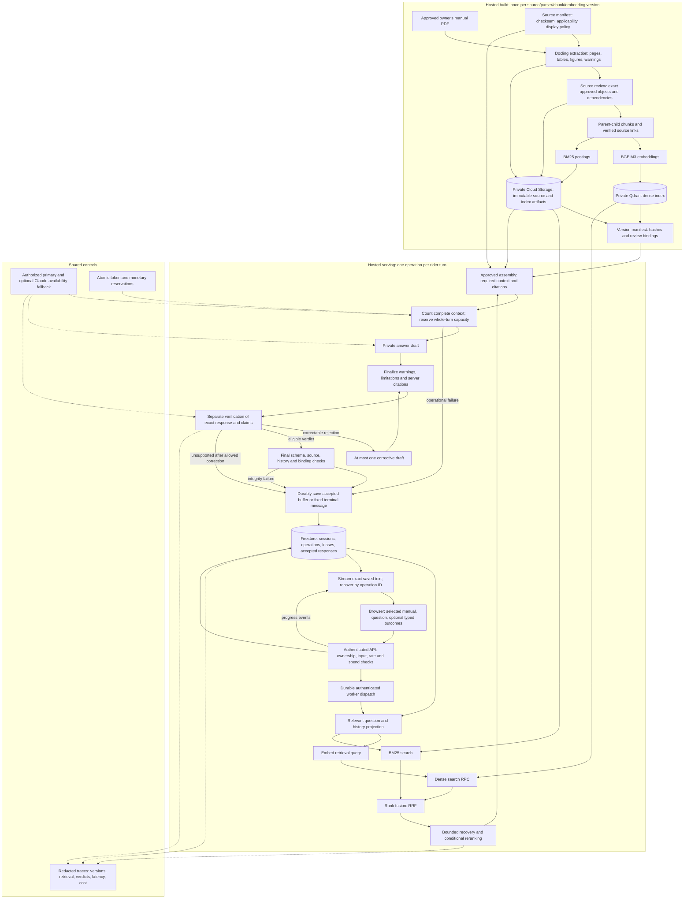

# MotoMedic architecture

Fresh baseline: 11 October 2026. [PRD.md](PRD.md) defines product behavior; [TRD.md](TRD.md) defines implementation contracts. [TODO.md](../TODO.md) gives the execution sequence.

Build a small, hosted question-answering assistant for the selected Royal Enfield Himalayan BS6 owner's manual. Ingest and embed the immutable manual once. For each rider turn, retrieve applicable evidence, privately draft a concise answer, separately verify that exact answer, save the accepted response, and stream the saved text.

This diagram describes the required architecture. It does not claim that every connection is deployed or accepted.

Dense search and BM25 execute concurrently after a history-aware retrieval query is prepared. Their ranks are fused; relevance alone never authorizes an answer. Conditional reranking resolves uncertain ordering of usable candidates. One bounded recovery may retrieve missing, reviewed dependencies. Missing source approval is a review problem, not a reranking trigger or a question for the rider.

Evidence assembly retains immutable evidence IDs, original page metadata, applicable conditions, warnings, specifications, units, table headers and verified references. Admit reviewed objects at their approved scope. A reviewed heading does not approve its entire parent body. Assemble compact complete context around approved evidence and mandatory dependencies; never omit required context to fit the model.

The current authorized primary model remains the default. Optional Claude receives only assembled evidence and relevant history, under its recorded authorization and budget. Only explicitly eligible primary availability failures can select it. Semantic rejection, invalid JSON, exhausted quota, source defects and integrity failure keep their original failure paths. The retired full-manual Claude method is excluded. Fallback remains disabled unless serving activation is authorized.

Drafting and verification are separate calls. Verification binds the exact finalized response, claims, question, relevant history, evidence and runtime versions. A partial answer states its limitation before verification. At most one correction and re-verification is allowed. Verification cannot cure wrong applicability, missing mandatory context or invalid citations.

Save only after final checks pass. Progress may be displayed while work proceeds; unchecked drafting tokens are private. Stream slices of the saved accepted buffer, never regenerate it for delivery. Recovery returns the same response and hashes. Processing must survive browser disconnection independently of the SSE connection. Authenticated Cloud Tasks dispatch to a Cloud Run worker is a proposed implementation, not a deployed fact. Leases and terminal reconciliation prevent indefinitely `RUNNING` operations. An uncertain provider completion must not trigger automatic paid replay.

| Rider outcome | Meaning and delivery |
| --- | --- |
| `SUPPORTED` | Verified complete or explicitly partial manual-backed answer. |
| `AMBIGUOUS` | One focused question about a rider-resolvable ambiguity supported by the source. |
| `UNSUPPORTED` | No releasable answer after permitted checks; fixed manual fallback and verified service route. |
| `SAFETY_STOP` | Applicable source-specific safety stop with priority over ordinary answering. |
| `SYSTEM_ERROR` | Provider, quota, malformed output, integrity, storage or other operational failure; fixed retry message. |

Fallback: “I couldn’t find relevant information in the selected manual to answer your question. Please contact Royal Enfield or an authorised service centre.”

System error: “I couldn’t check the answer right now. Please try again shortly.”

Fallback does not assert that the entire manual has no answer. Neither fixed message requires a successful model call. Citations expose authorized metadata and the verified OEM route; source policy prohibits rider access to the PDF, excerpts and figure crops.

| Storage | Responsibility |
| --- | --- |
| Private Cloud Storage | Immutable PDF/extraction/index artifacts and manifests identified by generation and hash. |
| Private Qdrant | BGE M3 vectors and selected-manual/version-filtered dense retrieval. |
| Versioned BM25 snapshot | Sparse retrieval over the same manual and chunk mappings, loaded once per worker/index version. |
| Firestore | Owned sessions, optional typed observations/attempts, idempotent operations, leases, accepted buffers and atomic quota/spend reservations. |
| Managed secrets | Provider credentials available only to authorized backend identities. |
| Redacted telemetry | Stage timing, verdicts, error categories, exact versions and estimated cost; no raw rider media or routine transcript copies. |

`ACTION_COMPLETED_UNRESOLVED` remains distinct from an observed normal component. Ordinary questions require neither authored question IDs nor diagnostic StepDefinitions. Prompt caching, if supported by the exact authorized model/account, is a cost/latency optimization separate from answer permission. Current validation recorded zero cached tokens. Exact-answer shortcuts are disabled for this integration.

## Current baseline and gaps

The 149-page owner's manual has SHA-256 `CF221A29E2F9CD5AF6E80A99774A697C814E8EDA661C27D72E519D8A7E80DA89`. Existing candidate index `index_a3282c4d98cf54595e4ba168` contains BGE M3 vectors, 532 search chunks, 277 parents and BM25, with private Qdrant infrastructure. Exact owner-delegated source approvals remain version- and scope-bound; they do not automatically approve general generation or public display.

| Area | Evidence before this reset | Required next change |
| --- | --- | --- |
| Retrieval | Dense/BM25 concurrency and RRF exist; serving searches NumPy vectors instead of the hosted Qdrant RPC. | Connect and measure the actual Qdrant request path against the immutable index. |
| Reranking | Open questions reach legacy missing-step review gates, bypassing conditional scheduling. | Use approved source dependencies and rank uncertainty without a step allowlist. |
| Source admission | Low-fuel evidence was not admitted; other approved contexts became too large. | Version a compact approved-object/dependency representation and check completeness independently. |
| Real answer coverage | v8 Haiku run `38160944967` released zero technical answers and answered zero of four clearly answerable or partially answerable turns; three contexts exceeded 8,192 tokens. | Fix admission/context and evaluate fresh source-reviewed cases before release. |
| Provider capacity | Drafting plus separate verification can exceed existing per-minute admission capacity. | Reserve and schedule a complete bounded turn, including possible correction and fallback. |
| History and delivery | Short follow-ups can lose retrieval topic; detached work can strand operations. | Preserve topic/outcomes and add durable execution, reconciliation and exact replay. |
| DevOps | Expiring Actions artifacts, competing runtime paths and weak image bindings remain. | Durable GCS inputs, one release manifest, provider-free PR checks, immutable images and rollback. |

Software tests establish boundary behavior, not factual coverage, deployed Qdrant/Firestore answering, live browser recovery, public readiness or production latency. Existing private services and their spending controls are unchanged by these documents. Photo and voice follow text acceptance.
